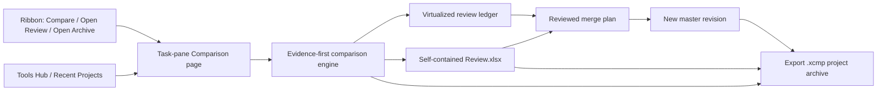
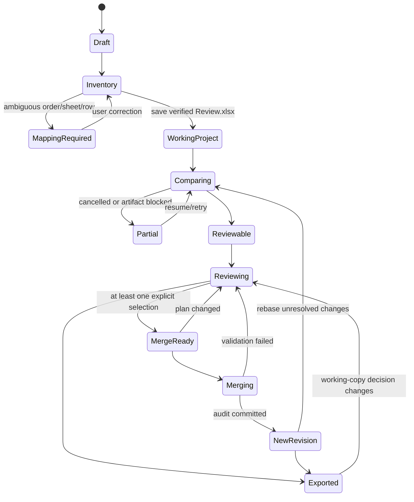
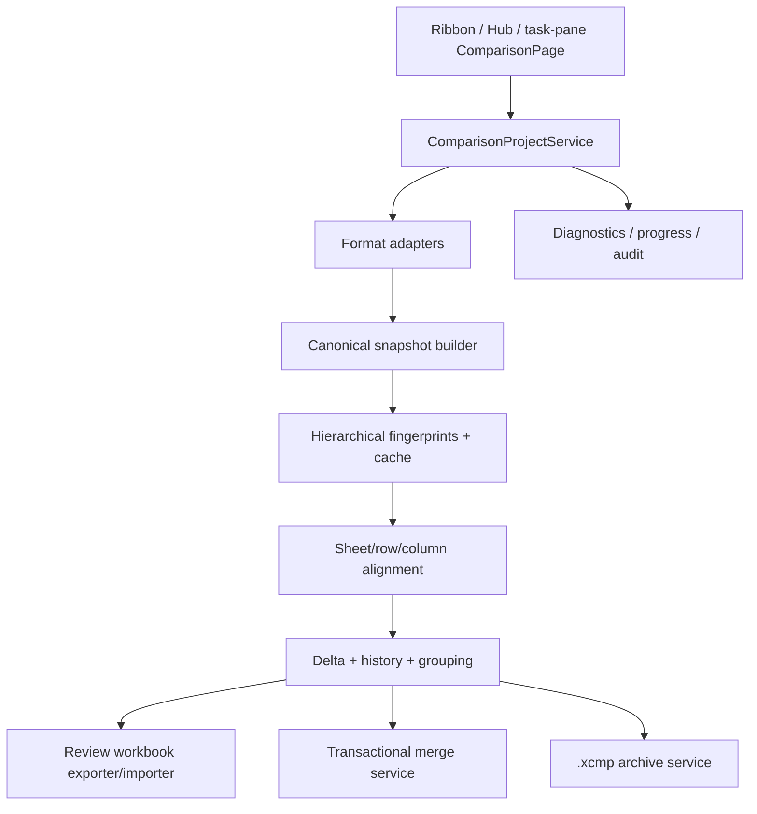

# Spreadsheet comparison — product and technical design

Status: **approved product direction; Phase 2 alpha, interactive Phase 3 decision slice, and Phase 4 safety foundations implemented**

Target: Excel Power Tools (`net48` Excel-DNA add-in with Excel-free logic in `ExcelPowerTools.Core`)

Last updated: 2026-07-28

Implementation checkpoint (2026-07-17): the ribbon's primary **Compare revisions** action and the Hub's
**Compare revisions (Alpha)** entry launch a multi-revision project over 2–20 distinct local `.xlsx`/`.xlsm`
files. Inventorying is immutable and hash-based. Filename and artifact evidence propose the revision order and
parent graph, but the setup window lets the user correct order, labels, and parents, choose the master and
optional trusted baseline, and requires explicit confirmation before analysis. Sources remain read-only and
the output is a newly created, validated, macro-free `Review.xlsx`.

The Phase 2 engine now performs conservative sheet mapping/rename inference, header and key detection, logical
row/column alignment, adjacent-edge history, branch/revert/conflict analysis, and grouping. Weak or ambiguous
identity becomes a stable verbose finding and blocks the affected logical history instead of being guessed; a
diagnostic Review workbook is still available. The implemented correction loop accepts exact sheet pairs,
header/no-header/data-start choices, and one-to-four paired key columns, then reanalyzes from retained immutable
parsed snapshots. Replacements and clears are reversible through new append-only events; prior events are never
rewritten. Visible changes and structural events are backed by integrity-checked embedded JSON containing
lineage and alignment corrections, alignment projections, findings, and exact changed-subject history. It
deliberately omits absolute source paths and does not embed complete source package bytes, so this alpha Review
workbook is not yet the full resumable project promised by the target design.

The Comparison task-pane workspace is also implemented. It selects and integrity-validates an existing
`Review.xlsx`, displays a bounded summary of the project and embedded package state, and opens a revalidated,
protected read-only launch copy without changing the selected report. Core has an immutable hydration boundary:
it validates and hashes one exact file occurrence through a single protected handle, retains the complete validated
state and replayed decision generation in memory, and can reject replacement or mutation before a later operation.
When a decision sidecar is present, the workspace now projects it into a virtualized, filterable ledger with
multi-selection and right-click actions for exact master/candidate choices, review statuses, and whole groups.
Queued decisions are in-memory only until the reviewer selects a new output name.
For complete analyses, an immutable decision-ledger catalog/request/generation engine now projects exact
revision evidence and the full subject-by-revision observation matrix into a separately hashed, manifest-bound
Custom XML sidecar. The initial workbook contains the zero-event root; sidecar schema v2 persists complete
versioned replay records and rebuilds effective state by reapplying every event through the same policy engine.
A copy-on-write boundary can apply an ordered request batch into one new, fully revalidated Review revision while
proving the source and every non-ledger package part remain unchanged. The task-pane save path rechecks the exact
hydrated package hash, validated identities, and stable Windows file occurrence on the same locked handle used for
derivation. This implements decision-history continuation, but not yet complete source-backed project resume,
visual snapshots, or per-revision history expansion.
The workbook remains unsigned: hashes and generation IDs detect corruption and inconsistent mutation within its
declared schema, but a coordinated attacker who rewrites every bound part and tip can create another internally
consistent package. Authenticity would require a future external trust anchor or digital signature.

The Excel-free formula boundary now preserves exact ordinary A1 formula text, typed cached results, and
character-level evidence; reconstructs only proven rectangular shared-formula followers; and inventories
array/dynamic/table/external-reference coverage without calculating or projecting it. Constants carrying
uninterpreted value metadata remain typed evidence but produce a grouped indeterminate-coverage finding rather
than a false exact match. General R1C1, structured/3D references, spill/table projection, external dependency
values, locale/recalculation behavior, `Formula2`, and `.xlsb` remain explicit live-Excel or later-format gaps.

Phase 4 now has isolated safety foundations, but no user-facing merge writer. A deterministic, immutable
merge-plan builder accepts only explicit current `UseCandidate` decisions from an exact byte-evidence catalog;
binds project/evidence/mapping/catalog/decision/master identities; freezes the master target and typed
formula/value precondition plus selected output; includes selected/master revision byte identities; rejects
legacy catalogs, stale events, non-mergeable/structural subjects, missing or unsupported write states, redundant
choices, inconsistent content identities, and ambiguous physical targets; and emits decision-set and plan
SHA-256 identities. Formula and Value remain independent logical aspect operations, never a sequential write
recipe. A second pure compiler groups those aspects by exact master occurrence and emits one complete intended
cell content (`SetFormula`, `SetConstant`, or `ClearContent`). It rejects formula/non-blank-value hybrids and
inconsistent master evidence; ambiguous value-only/formula-addition cases retain explicit master proof
requirements instead of assumptions. The plan always names the still-required source, finding, target,
cell-synthesis, writer, full-diff, and publication checks, with dependency/group checks added for formulas.

A versioned path-free proof/receipt contract binds each validation to both the exact plan and synthesis hashes,
sorts one proof per required flag, rejects missing/duplicate/extra/stale proofs, and produces the hash consumed by
the recovery journal. Concrete validators cover deterministic cell synthesis, rebuilding the frozen
plan/synthesis from the current decision/mapping generation, and an OOXML master preflight. That preflight opens
one exact source occurrence with write/delete sharing denied, owns and hashes its bounded bytes, retains the
source handle, re-parses those owned bytes read-only, proves exact formula/value target preconditions and
conditional master facts, and exposes only a copy-from-owned-bytes operation for a future writer. Its portable
proofs omit the local path. The future writer must consume that still-active lease; reopening the path would void
the proof. Project/artifact findings, formula dependency/group, writer-envelope, full-output-diff, and publication
proof producers remain gated work, so a production-complete receipt cannot yet be issued.

The Windows publication
primitive performs create-new publication only in one exact local fixed NTFS directory: it retains the stage and
directory chain, proves an absolute volume-GUID target, rejects path aliases and reserved device leaves, rechecks
identity/length/hash/streams/link count immediately before and after rename, and never replaces a destination.
The portable merge journal is a strict four-record cumulative hash chain
(`Prepared` → `Validated` → `OutputPublished` → `AuditCommitted`). A separate machine-local binding, create-new
checkpoint store, and pure restart matrix now reject gaps, forks, mismatches, missing artifacts, and unavailable
evidence without overwrite, deletion, or inference. The supported publication threat model still excludes a
coordinated same-user or privileged actor changing streams, links, or namespace state between checkpoints.

The current in-process safety envelope is 256 MiB per OOXML input, 768 MiB across all inputs, 2,000,000 stored
cells, 10,000,000 bounded grid cells, and 32 MiB of embedded Review state in chunks of at most 4 MiB. Review
import additionally preflights a 128 MiB compressed ZIP envelope and 768 MiB aggregate declared expansion.
The grid estimate and alignment projection use each sheet's first-to-last formula/value rectangle. Physically
stored blank or formatting-only cells outside it are reported and ignored for alignment, but blank presence
inside it is retained as secondary evidence. All physical cells continue to count against the parsing/memory
stored-cell limit because they must be read before they can be classified safely.
Unrelated and legacy entries remain capped at 64 MiB; only the eight canonical, workbook-listed and
relationship/content-type-bound projection worksheets may reach 512 MiB each, and only their unique bound shared
string table may reach 256 MiB. Streaming validation then caps the projection at 8,000,000 cells and 100,000
hyperlinks while using a disk-backed shared-string index with a bounded LRU cache. The current decision sidecar
envelope is 16 MiB, 250,000 XML elements, 10,000 replay events, and
bounded per-event collections; larger histories require the planned archive-backed store. Visible character
detail remains limited to Excel's 32,767-character cell ceiling with an explicit
truncation marker while exact text stays in embedded state. Progress, cancellation, and privacy-safe learned
elapsed-time estimates are wired into the add-in workflow. These are conservative alpha limits, not final
product ceilings.

Synthetic Pipeline4-shaped alignment regressions are green, but validation and threshold tuning against the
real Pipeline4 revision corpus remain pending. The headless 10k/100k/250k Review scale matrix and an independent
fresh-process 250k validation pass are green. A 2026-07-23 real-Excel 10k attempt passed generation and both
pre-Excel semantic checks, but this managed Office environment opened both the Review workbook and an unrelated
known-good control workbook read-only and refused a read/write access transition (`0x800A03EC`). The repaired
runner reports that as `EPT.RETENTION.EXCEL.READWRITE_UNAVAILABLE` and leaves no Excel process behind; actual
open/save/reopen retention therefore remains unmeasured, as do x86 behavior and image snapshot rendering.
Also pending are `.xlsb` and delimited inputs for multi-revision
projects (delimited files remain supported by the separate exact two-file preview); arbitrary duplicate
row/column resolution; budgeted visual snapshots, complete source-backed project reopen/resume, and Excel-sheet
synchronized context menus; transactional merge/new-revision; and complete `.xcmp` archive export/import.
Real-Excel cold-load/retention and the remaining technical spikes below also remain open.

## 1. Executive summary

Spreadsheet comparison is a project-oriented workflow for understanding and reconciling several workbook
revisions that may have been renamed, emailed, independently edited, or partially merged. Its first promise is
an exact, explainable account of formula and value changes. Its second promise is a safe, reviewable, one-way
merge into a new revision. Attribution is useful supporting evidence, but an emailed workbook cannot provide
reliable cell-level authorship after the fact.

The feature has two cooperating surfaces:

- A rich **Comparison** page hosted in the existing Power Tools task pane for setup, progress, filtering,
  multi-selection, right-click decisions, snapshots, and merge preparation. A detachable/modeless pop-out is a
  possible later enhancement, not the v1 navigation model.
- A macro-free, resumable **Review.xlsx** workbook for a durable, shareable Excel-native report. For projects
  within the measured Excel/package ceilings, it embeds the complete canonical session state and needs no
  sidecar. Archive-first extreme mode is an explicit exception: a scoped Review.xlsx is labelled incomplete and
  the complete portable contract is the required `.xcmp` export.

A separate **Export Comparison Project** command produces a complete `.xcmp` ZIP64 archive containing exact
input bytes, the review workbook, snapshots, evidence, diagnostics, decisions, and merge outputs.

The comparison engine is deterministic and evidence-first. Semantic interpretation—alignment, grouping,
equivalence labels, severity, and domain profiles—may reduce visual noise but may never delete or overwrite the
atomic evidence beneath it.

## 2. Product priorities

In order:

1. Identify exact changes across two or more revisions.
2. Review, select, and merge chosen formula/value states into a new master revision.
3. Preserve artifact metadata, reviewer identity, notes, and version-level provenance.

The practical target is a file touched by several people through renamed or emailed copies that can diverge in
parallel. A common ancestor and most emitted revisions are usually available. The user normally knows the
latest reviewed file; otherwise the tool assists inspection but does not claim that a file was reviewed.

## 3. Goals

- Compare `.xlsx`, `.xlsm`, `.xlsb`, `.csv`, `.tsv`, and separated-value `.txt` revisions.
- Support a revision graph rather than assuming one perfectly named linear sequence.
- Infer revision labels, chronological order, parents, sheet mappings, headers, and row keys with explicit
  confidence and user correction.
- Treat formulas and typed constants as primary content; treat cached calculated-result changes as secondary.
- Preserve exact text and formula evidence and show character-level differences.
- Align inserted/deleted rows so one insertion does not become thousands of false cell changes.
- Group repeated changes without hiding their individual cells.
- Preserve decisions and full history in a resumable standard-mode review workbook, or in the explicit
  archive-first durable store until the required complete archive is exported.
- Create a new output revision; never overwrite an input or the current master.
- Produce verbose, code-traceable diagnostics with stable identifiers and corrective actions.
- Remain responsive and cancellable at the stated worst-case scale.

## 4. Non-goals for the first release

- Reconstructing trustworthy cell-level authorship from ordinary local or emailed files.
- Executing VBA, refreshing queries/connections, updating external links, or recalculating source workbooks.
- Directly editing any input workbook during comparison.
- Merging formatting, comments, validation, shapes, charts, PivotTables, queries, VBA, protection, or print
  settings. These may be inventoried or reported as unsupported/secondary aspects, but the merge unit is cell
  formula/value only.
- Concurrent collaborative editing of one comparison project.
- Permanent-record management, digital-signature workflows, or archive retention policy.
- Claiming two unsupported or unreadable workbook regions are equal.

## 5. Settled product decisions

| Area | Decision |
|---|---|
| Main UI | Hybrid: Comparison page in the Power Tools task pane plus generated Review.xlsx |
| Primary action style | Right-click context menus; Ctrl/Shift multi-selection is mandatory |
| Analysis | Multi-revision history over an inferred and user-correctable revision graph |
| Master | Latest revision and merge destination; explicitly confirmed by the user |
| Trusted baseline | Latest known reviewed revision; independent from master |
| Collapsed history | First/trusted state to current master, with intermediate-state count and badges |
| Expanded history | Every distinct state/revision, timestamps, links, snapshots, formulas/values, manual fills |
| Comparison priority | Formula changes, then typed value changes, then cached-result-only changes |
| Noise | Never hidden; classified and shown quietly, with exact character evidence |
| Repeated changes | Grouped; users may act on a group or override individual children |
| Decisions | Append-only audit events; facts and decisions remain separate |
| Partial merge | Allowed; only explicit selections apply, unreviewed remains unreviewed |
| Merge output | New file; the user edits and confirms the destination name before staging/validation |
| Merge scope | Formula/value only; Excel-enforced formula groups are atomic |
| After merge | Output becomes a new child revision and the project’s new master |
| Review persistence | Standard mode: one complete self-contained Excel workbook; archive-first: explicitly scoped projection plus durable working store |
| Full export | `.xcmp` with exact inputs/all artifacts; recommended in standard mode and required to complete archive-first mode |
| Progress | Phase/file/sheet progress plus ETA learned from local prior timings |
| Logging | Verbose, stable IDs, source locations, full artifact context, suggested corrective actions |
| Color | Red-to-green quality scale, violet special scale, neutral gray; centralized semantic constants |

## 6. Experience architecture



### 6.1 Ribbon and Tools Hub

The ribbon remains intentionally small:

- Add one prominent **Compare** command in a Review/Analyze workflow group.
- Add **Open Review Workbook...** and **Open Project Archive...** as distinct secondary menu/Hub commands.
- Keep project setup, revision mapping, diagnostics, filters, and merge controls out of the ribbon.

All commands also appear in `PowerToolsPane.BuildToolCatalog`, together with Recent Projects and project
export. This follows the repository rule that frequent context-driven actions live in the ribbon while
GUI-heavy functions live in the task pane. Recent Projects shows the artifact kind and capability badges:
**Review only**, **Sources attached**, **Archive complete**, **Dirty since export**, and **Merge capable**.

### 6.2 Task-pane Comparison page

The main workspace is a rich page hosted by the existing resizable Power Tools task pane. It contains:

1. **Project setup** — inputs, inferred labels, order, parent, master, trusted baseline, parsing profile.
2. **Revision map** — graph and sortable table with confidence/evidence.
3. **Progress** — current phase, revision, sheet, units, throughput, elapsed time, ETA range, warnings.
4. **Overview** — counts, coverage, unsupported aspects, branch-only/reverted/conflicting changes.
5. **Ledger** — virtualized grouped changes with filtering and multi-selection.
6. **Detail** — first/master/selected content, full history, character diff, snapshots, dependencies, links.
7. **Diagnostics** — searchable findings with copy/export and corrective actions.
8. **Merge plan** — selected changes, unresolved count, stale checks, output validation.

### 6.3 Review interaction

Right-click is the primary decision interaction. The menu is computed from the current selection and offers
only actions valid for all selected records:

- Use master state.
- Use a candidate content state (revisions sharing identical content are shown together).
- Mark equivalent/no substantive change.
- Mark needs investigation.
- Clear decision.
- Expand/collapse group.
- Open immutable snapshot, full history, diagnostic evidence, or the original through **Open original safely**.
- Apply the action to selected children or explicitly to the entire group.

Selecting a group header never silently includes hidden children unless the user chooses a whole-group action.
When one child is overridden, the group status becomes **Mixed**.

The same semantic menu is available as a custom Excel context submenu while Review.xlsx is active. It resolves
selected table rows and non-contiguous `Selection.Areas` through hidden stable IDs, summarizes the scope before a
bulk action, and never interprets arbitrary cells in an unrelated workbook as comparison records.

Task-pane and workbook selections are two synchronized views of the same stable IDs: selecting a ledger row can
navigate to its visible Review.xlsx projection, and selecting projected rows updates the task-pane detail. A
collapsed group is still a selectable record with an explicit child count. Hidden children are affected only by
a labelled **Apply to whole group** command, never by an ordinary multi-row action.

### 6.4 Change presentation

Each collapsed logical change shows:

- logical sheet/row/column or domain identity;
- trusted/first content → master content;
- selected winning content;
- number of revisions and distinct intermediate states;
- change aspect and direction;
- alignment confidence;
- badges for reverted, branch-only, conflicting, equivalent/noise, stale, or unsupported context;
- internal links to before and after evidence/snapshot cells in separate columns.

Expanded history shows every revision state chronologically and by branch. Revisions with identical content are
collapsed under one candidate state but remain individually visible on expansion. "Noise is never hidden" means
that every exact difference contributes a visible finding/group row and count in the default view; only child
detail is collapsed. No default filter suppresses an aspect or equivalence class.

### 6.5 Snapshots and context

Every reviewed change can request all of the following:

- a small neighborhood around the cell or changed region;
- the complete logical row;
- exact formula and typed value;
- cached calculated result, clearly labelled as cached;
- direct precedents and dependents with links, computed lazily within declared formula-parser coverage;
- an embedded visual snapshot preserving original formatting and manual cell fills;
- internal links to immutable evidence/snapshot locations for each involved revision.

Snapshots are created per distinct changed region/group, not per individual cell, to avoid duplicating the same
context thousands of times. Original fills remain visible; comparison emphasis uses borders, markers, labels,
and side bands where a replacement fill would obscure evidence.

An explicit **Open original safely** add-in command is secondary to the internal snapshot link. It revalidates
the artifact hash and uses the read-only safe-open path with macros, links, refresh, events, and calculation
disabled; Review.xlsx never contains a normal external hyperlink that can bypass those controls. Formula
dependency context is best-effort and lazy: names, tables, external references, dynamic arrays, and unsupported
constructs carry coverage labels instead of implied completeness.

Snapshot generation has project-level count, pixel, and byte budgets measured by the scale spike. Typed mini-grid
evidence and exact content are always retained. Images are prioritized for selected/high-severity groups and may
be generated on demand; a budget overflow produces an explicit archive-only/image-omitted marker, never silent
evidence loss.

## 7. Project and review state



Draft setup exists only in memory until inventory/preflight succeeds. Before the long comparison begins, the
add-in creates and verifies the selected durable working store: Review.xlsx in standard mode, or the durable
project directory plus a scoped Review.xlsx in archive-first mode. Stage checkpoints are saved at safe
boundaries. Cancelling before that store exists loses only temporary setup/preflight work; cancelling afterward
is resumable through the add-in without relying on TEMP/cache.

Cancellation is cooperative at engine chunk boundaries. Before WorkingProject exists, inventory/mapping work is
temporary and is not resumable. After it exists, completed inventory, fingerprints, mappings, and comparison
edges are durable checkpoints. Excel open/save and final archive publication are explicitly labelled
non-interruptible phases; `.xlsb` work uses an isolated process that may be terminated only where doing so cannot
damage an input or published output. Cancellation never leaves an input or final output partially modified, and
UI responsiveness never relies on `DoEvents` reentrancy.

## 8. Revision inventory and lineage inference

### 8.1 Evidence

Revision order and parentage are separate properties. Inference uses:

- explicit filename tokens such as `r1`, `r02`, `v1`, `v2.1`, and `rev3`;
- competing interpretations for terminal numbers such as `31` (`31` versus `3.1`);
- source creation/modified timestamps and Office metadata as weak evidence only;
- version-level provenance such as `lastModifiedBy`, document creator, application/version, and optional cloud
  version metadata, each labelled with its source and reliability;
- exact duplicate hashes;
- workbook/sheet structure and content similarity;
- minimum plausible delta to an earlier candidate;
- user-provided short descriptions.

The setup table displays every parsed candidate, score, reason, and weak provenance field. Low-confidence parent
edges are dotted in the graph. The user can reorder revisions, reconnect parents, edit labels, and mark
master/trusted baseline. Confirmed corrections are append-only mapping events saved in a new mapping generation;
they never rewrite the immutable raw observations or historical inference proposals.

### 8.2 Comparison edges

A project with `N` revisions normally compares the `N-1` parent→child edges in its revision tree, not all
`N*(N-1)/2` pairs. Histories and first→master views are composed from those adjacent deltas. Explicit endpoint
and three-way base/mine/theirs comparisons may be computed on demand.

## 9. Input adapters and immutable snapshots

All inputs are hashed before and after reading. A change during extraction invalidates that read. Inputs are
opened read-only and are never normalized in place.

### 9.1 `.xlsx` / `.xlsm`

- Stream Open Packaging Convention parts with `XmlReader`/Open XML SDK.
- Resolve shared strings, style IDs, dates, booleans, errors, formulas, and cached values into canonical typed
  records before hashing.
- Preserve and hash `vbaProject.bin` in `.xlsm`; never execute it. Detect Office/VBA signature parts. Signed
  masters are comparison-only in v1: merge is blocked because any save may invalidate a signature.
- Record unsupported parts and coverage explicitly.

### 9.2 `.xlsb`

- Prefer a dedicated read-only binary adapter if a suitable managed dependency is accepted.
- The baseline fallback uses an isolated Excel instance on a byte-for-byte temporary copy only inside the safety
  envelope proven by the required spike.
- Force macros off, calculation manual, events off, link updates off, alerts off, and refresh off before open.
- Extract one workbook at a time, restore all application state in `finally`, close without saving, and verify the
  temporary/input hashes.
- Files or binary structures outside that proven envelope are blocked with corrective actions; they are never
  opened on a best-effort promise or assumed equal.

### 9.3 Separated-value files

Reuse the existing round-trip-faithful CSV subsystem and persist an import profile containing:

- encoding and BOM;
- delimiter, quote, escape, and comment rules;
- newline style and trailing newline;
- header decision and confidence;
- locale/type interpretation used only for equivalence labels;
- whether formula-looking strings are text (always true for source evidence).

Decoded field content is primary. Encoding, delimiter, quoting, newline, header, and row-order changes are
reported separately. `001` and `1` are different exact values but may receive a quiet **numerically equivalent**
label. Quoting-only changes must not fabricate a field-value change.

### 9.4 Canonical cell aspects

For every physically stored cell needed by the comparison, retain separately:

- exact formula text;
- normalized R1C1/formula shape used only for equivalence and grouping;
- typed constant (`blank`, string, number, boolean, error, date serial plus date-system context);
- cached calculated result and cache trust state;
- display text where available;
- selected contextual formatting, especially interior fill used by editors as an unreliable change marker;
- original sheet/address provenance.

Non-content package aspects have an explicit v1 disposition:

| Aspect | v1 result |
|---|---|
| Formula and typed value | Atomic review finding; eligible for merge |
| Cached result | Secondary atomic diagnostic; never merged independently |
| Row/column/sheet structure | Review event used for identity/alignment; not merged |
| Manual interior fill | Quiet secondary review/context finding when changed; visible but not a merge candidate |
| Other style/comment/validation | Inventory/coverage diagnostic when changed; no atomic merge candidate in v1 |
| Drawings/charts/Pivots/queries/connections/links/VBA/protection/print settings | Coverage hash and changed/unsupported diagnostic only |

A changed coverage hash is never presented as an unexplained content change or silently folded into “identical.”

## 10. Identity and alignment

### 10.1 Sheet identity and rename detection

Evidence is ranked:

1. add-in-owned workbook/sheet GUID already present in an input, treated as supporting lineage evidence;
2. unique `Worksheet.CodeName` within a known lineage;
3. exact sheet name;
4. tables, named ranges, headers, dimensions, formula shapes, and content fingerprints;
5. workbook-local `sheetId`, relationship ID, and part path as supporting evidence only.

A matching code name plus changed tab name is a strong rename candidate, not universal proof. Copied/recreated
template sheets may be ambiguous. The preflight displays candidate mappings and requires confirmation below the
configured confidence threshold in the target workflow. In the current alpha, a below-threshold sheet mapping
becomes a finding and the prepublication alignment review exposes the exact physical candidate occurrences.
Lineage IDs for generated
merge revisions live in the comparison project, not inside the output workbook, so a formula/value-only merge
does not introduce hidden package metadata. Duplicate input GUIDs caused by copying are detected and resolved
explicitly.

### 10.2 Row and column alignment

Strategies, in descending preference:

1. user-confirmed key columns for table-like data;
2. strong inferred key columns;
3. unique content anchors plus bounded patience/Myers sequence alignment;
4. formula/header/content fingerprints;
5. positional alignment for model-like sheets;
6. user mapping when candidates remain ambiguous.

An inserted/deleted row is represented as one structural event plus its own cell contents. Downstream physical
addresses are mapped to the same logical row IDs and do not become false changes. Duplicate rows use occurrence
and neighbor context; unresolved duplicates receive block-level or low-confidence attribution rather than a
fabricated exact match. Arbitrary user resolution of duplicate row or column occurrences is not part of the
current correction slice and remains pending.

### 10.3 Header detection

The existing `CsvDetect.DetectHeaderRow` algorithm provides useful evidence:

- expected width is the modal non-comment row width;
- only the first 25 records are scanned;
- a candidate must have modal width, at least half its fields populated, and at least 60% nonnumeric fields;
- the first qualifying row wins.

It currently returns only an index and can misclassify an early text-heavy data row. Comparison therefore uses a
new scored result:

```text
HeaderDetectionResult
  CandidateRow
  Confidence
  RunnerUpMargin
  Evidence[]
  Decision = StrongHeader | Ambiguous | Data
```

Additional evidence includes type transition into subsequent rows, repeated structure across revisions,
normalized label agreement, table metadata, and candidate uniqueness. Initial tunable policy: accept a header
only when the score is strong and separated from the runner-up; **weak or ambiguous detection treats the row as
ordinary data**. The raw candidate remains visible in diagnostics.

### 10.4 Key-column inference

Key inference runs only after a strong/confirmed header. Automatic inference currently considers single and
two-column composite keys; an explicit correction may confirm one to four ordered Before → After column pairs.
Candidates are scored by:

- nonblank coverage;
- uniqueness and duplicate rate;
- stability and overlap across parent/child revisions;
- type consistency;
- resistance to the changes already observed;
- exact normalized header aliases, then domain profile aliases;
- content profiles such as address/tag patterns.

Weak key detection falls back to sequence/content alignment. The alpha alignment review can set or clear exact
header and key roles; the broader task-pane decision/right-click workflow remains Phase 3 work. Confirmed
mappings are project data, never mutations of the source workbook.

### 10.5 Implemented alpha correction loop

The current correction window is a bounded prepublication loop, not the full Phase 3 review experience:

1. The command reads, hashes, parses, and bounds every source once, retaining immutable command-lifetime
   snapshots.
2. An incomplete analysis presents its stable findings and exact structured scopes. A complete analysis with
   active confirmed overrides keeps those choices visible and editable before publication. The user may confirm
   or replace a sheet pair; choose Auto, No header, or a physical header row plus optional first-data row on each
   mapped side; or confirm one to four paired key columns.
3. Confirm, replace, and clear-to-Auto requests produce a new deterministic correction generation. Active lists
   show the current choice, while every event, reviewer snapshot, timestamp, note, and superseded confirmation
   ID remains append-only. Exact revision IDs, physical sheet keys, and table/physical row or column provenance
   are validated; stale, out-of-range, duplicate, and conflicting choices fail loudly.
4. **Rerun analysis** rebuilds mapping identity and history from the retained snapshots and the new generation.
   The loop ends with one complete publication or an explicit diagnostic publication; it never publishes a
   partial result silently.

These retained snapshots disappear when the command ends. Durable decisions, visual snapshots, reopen/resume,
merge, and archive lifecycle remain outside this slice.

## 11. Difference semantics

### 11.1 Primary aspects

1. Formula text changed.
2. Formula ↔ constant transition.
3. Typed constant changed.
4. Same formula with a different cached result (secondary diagnostic).
5. Added/deleted/moved row, column, sheet, or comparable region needed to explain identity.

Formula changes remain substantive even when calculated results match. Same-formula/different-result findings are
secondary because caches may be stale or depend on links/environment.

Structural findings are first-class review evidence but are not mergeable in v1. Their context menu offers
navigation, notes, grouping, and **Reviewed — no structural merge**, but not **Use candidate**. Likewise, a
formula/value candidate whose target row, column, or sheet does not exist in the master is disabled with a
`CMP-MERGE-STRUCTURE-REQUIRED` finding. This applies to Office and separated-value files; the tool never creates
or deletes structure while describing the operation as a formula/value-only merge.

### 11.2 Exact versus equivalent

Every exact difference remains in the evidence ledger. Quiet equivalence classifications include:

- whitespace-only;
- case-only;
- punctuation-only;
- leading Excel text-guard apostrophe only;
- numeric text versus numeric value;
- blank versus formula returning an empty string;
- numerically close values;
- textually different but normalized-equivalent formulas;
- row-order-only change.

Equivalent/noise findings are gray and represented by visible group/finding rows in the default view; repetitive
child detail is collapsed, separately counted, expandable, and fully searchable.

### 11.3 Character-level differences

- Compute differences only after an exact cell/formula mismatch is known.
- Use Unicode grapheme-aware runs for text and retain a literal character view.
- Show additions and removals inline with green/red runs.
- Provide visible-space, tab, CR, and LF glyphs.
- Formula tokenization may improve grouping, but a literal character diff is always available.
- Cache results by old/new content hash and cap pathological previews without truncating stored evidence.

## 12. History and grouping

A logical subject may have several revision observations and several distinct content states. The model separates:

- **subject identity** — logical sheet/row/column/aspect;
- **observation** — that subject’s state in one revision;
- **transition** — parent→child state change;
- **candidate state** — one distinct formula/value supported by one or more revisions;
- **review decision** — the candidate chosen by a reviewer;
- **merge application** — a verified write into a new output revision.

Grouping may use:

- identical old→new transitions;
- normalized formula-shape edits;
- contiguous ranges;
- row/column insertion blocks;
- sheet and field/column;
- profile-specific concepts such as Pipeline4’s node/field grouping.

Grouping is a projection only. Every child retains its stable ID, exact evidence, confidence, and independent
decision override.

## 13. Core data model and identifiers

```text
ComparisonProject
  ProjectId, SchemaVersion, CreatedUtc, UpdatedUtc, OptionsHash, ThemeVersion

Revision
  RevisionId, ByteContentId, Label, Order, ParentRevisionId, IsMaster, IsTrustedBaseline
  Format, SourceLabel, OriginalBaseName, PathClass, LocalLocatorKey
  ByteLength, Sha256, SourceTimestamps, Description
  DocumentCreator, LastModifiedBy, ApplicationVersion, CloudVersionMetadata, ProvenanceReliability
  ParserVersion, ImportProfileId, Coverage

LocalArtifactLocator                 local-only; never serialized into Review.xlsx/portable archive metadata
  ProjectId, RevisionId, AbsolutePath, MachineScope, LastVerifiedUtc

SheetIdentity
  LogicalSheetId, RevisionId, Name, CodeName, AddInGuid, Order
  Bounds, PhysicalCellCount, StructureHash, ContentHash, MatchConfidence

LogicalSubject
  SubjectId, LogicalSheetId, RowIdentity, ColumnIdentity, Aspect

Observation
  ObservationId, SubjectId, RevisionId, ExactType, ContentHash
  Formula, Value, CachedResult, DisplayText, Provenance

Transition
  TransitionId, EdgeId, SubjectId, BeforeObservationId, AfterObservationId
  ChangeKind, AlignmentConfidence, GroupId, EquivalenceTags

DecisionEvent
  EventId, SubjectId/GroupId, PriorDecision, NewDecision, SelectedObservationId
  ReviewerSnapshot, CreatedUtc, Note, SelectionScope, GenerationId

Diagnostic
  EventId, FindingUid, Code, Severity, RunId, Stage, MessageKey, MessageArgs
  ArtifactContext, SourceLocation, Exception, SuggestedActions

MergeRun
  MergeId, ProjectId, SourceMasterRevisionId, OutputRevisionId
  GenerationId, MappingGenerationId, MergePlanHash, SelectedDecisionIds
  State, PreconditionResults, OutputHash, ValidationResults

InferenceProposal
  ProposalId, GenerationId, Kind, Candidates, Scores, Reasons, CreatedUtc

MappingEvent
  MappingEventId, PriorMappingGenerationId, NewMappingGenerationId
  Kind, SubjectIds, PriorMapping, ConfirmedMapping, ReviewerSnapshot, CreatedUtc
```

Identifier rules:

- `RevisionId`: project-scoped occurrence/node ID. Two identical emailed copies remain separate revisions with
  separate labels, paths, timestamps, descriptions, and graph positions.
- `ByteContentId`: SHA-256 of exact input bytes; identical occurrences share this content address.
- `LogicalSheetId`: persisted project identity, based on confirmed lineage/GUID rather than display name.
- `SubjectId`: hash of logical sheet, logical row, logical column, and aspect; physical addresses are context only.
- `ObservationId`: hash of subject, revision, exact type, and content hash.
- `TransitionId`: hash of edge, subject, before observation, and after observation.
- `FindingUid`: hash of diagnostic code plus semantic target and stable evidence keys; never localized prose,
  severity, filename, or volatile physical row number alone.
- `EventId`, `ProjectId`, `RunId`, `MergeId`: generated GUID/ULID-style occurrence identifiers.

Large values and repeated payloads are content-addressed blobs. Human-readable messages are projections from
structured message keys/arguments and are not identifier inputs.

## 14. Component architecture and repository placement



Suggested new locations:

```text
src/ExcelPowerTools.Core/Comparison/
  Model/                 project, revision, subject, observation, decisions
  Revision/              label/order/parent inference
  Canonical/             typed values, formulas, fingerprints, chunks
  Alignment/             sheet/header/key/row/column mapping
  Diff/                  exact diff, char diff, equivalence, grouping
  Persistence/           manifest/chunk schemas, checksums, cache indexes
  Diagnostics/           structured findings and progress events
  Theme/                 semantic visual roles (no System.Drawing dependency)

src/ExcelPowerTools/Commands/ComparisonCommands.cs
src/ExcelPowerTools/UI/ComparisonPage.cs
src/ExcelPowerTools/UI/ComparisonTheme.cs
src/ExcelPowerTools/Interop/ComparisonExcelReader.cs
src/ExcelPowerTools/Interop/ComparisonMergeWriter.cs
src/ExcelPowerTools/Persistence/ReviewWorkbookStore.cs
src/ExcelPowerTools/Persistence/ComparisonArchive.cs
src/ExcelPowerTools/Settings/ComparisonSettings.cs

tests/ExcelPowerTools.Tests/Comparison/
```

Pure inference, canonicalization, alignment, diffing, grouping, IDs, schemas, and archive validation belong in
`ExcelPowerTools.Core`. Excel COM, `System.Drawing`, dialogs, workbook rendering, and merge writes stay in the
add-in project.

### 14.1 Dependency posture

- Pin a compatible `DocumentFormat.OpenXml` version in both projects if the prototype confirms acceptable
  packed-XLL size/startup cost.
- Avoid a native SQLite dependency initially; use versioned chunk files plus compact indexes (disposable copies in
  `%TEMP%`, durable archive-first copies in the project directory) and embedded Custom XML in standard-mode
  Review.xlsx. Revisit only if benchmarks demonstrate a clear need.
- Keep cache formats private and disposable. Project/review schemas are versioned durable contracts.

## 15. Hierarchical fingerprints and caching

Fingerprint levels:

1. whole-file SHA-256 for exact duplicates and immutable identity;
2. package-part hashes for worksheets, shared strings, styles, comments, drawings, VBA, links, etc.;
3. canonical sheet and row-block/tile hashes;
4. sparse cell-aspect hashes;
5. exact old/new payload and character diff only for changed cells.

Shared-string and style indexes must be resolved before semantic hashing, otherwise harmless package index
renumbering would fabricate mass changes.

Snapshots are streamed into sparse 128–256-row chunks. The engine never allocates a worst-case full rectangular
`5000 × 200` grid for every sheet/revision. Memory holds bounded active chunks; completed deltas and indexes are
persisted to disk.

Cache keys include input hash, parser/canonical schema version, comparison options, import profile, and alignment
strategy. Cache data is performance-only; deleting it cannot lose review evidence or decisions.

## 16. Review.xlsx persistence

`Review.xlsx` is macro-free and self-contained for inspection and decision resumption. Here, self-contained
means that its declared review scope, exact evidence, snapshots, mappings, decisions, notes, audit history, and
stage checkpoints survive without TEMP data or a companion sidecar. It does not duplicate the exact source
bytes: navigation and merge reattach artifacts by `ByteContentId` or obtain them from an imported `.xcmp`.

Suggested visible sheets:

- **Overview** — project summary, lifecycle/dirty state, completeness, counts, warnings, master/trusted baseline.
- **Revisions** — revision graph/table, portable source labels/basenames, hashes, timestamps, descriptions,
  inferred provenance, reliability labels, and mapping confidence. The task pane may show a full local path from
  the machine-local locator registry, but that path is not written into the workbook.
- **Changes** — grouped review ledger with stable hidden IDs and permitted decision/note columns. Every exact
  finding is represented even when child detail is collapsed.
- **Details** — selected first/master/candidate states and visible rich-text character diffs, including whitespace
  glyphs; this works in standalone Excel without the task pane.
- **Snapshots** — embedded regional images or typed mini-grids plus internal navigation.
- **Diagnostics** — portable verbose findings and suggested actions.
- **Merge Log** — prepared, published, recovered, failed, and committed merge runs.
- **Legend** — semantic colors, icons, tags, exact settings, parser coverage, and theme version.

Machine-readable state lives in namespaced, chunked Custom XML parts:

- one small manifest with project/session/schema/theme/generation IDs, source archive generation, dirty state,
  declared scope, measured ceilings, chunk inventory, and a `ProjectStateRoot` over the ordered canonical chunks;
- immutable revision occurrences and raw observations;
- inference proposals and append-only confirmed mapping generations as separate records;
- evidence/history/group chunks plus character-diff runs;
- append-only decision/audit chunks;
- diagnostics, merge journal/history, and stage checkpoints;
- per-chunk SHA-256 and sequence number.

### 16.1 Working-project lifecycle

After preflight, the user chooses and saves Review.xlsx before the expensive comparison. In standard mode, its
validated Custom XML stream is the authoritative working-project store. The in-memory model, local artifact
locator registry, and disposable cache accelerate it but never own portable facts or decisions. Engine
checkpoints save at stage boundaries; decision/note batches are appended and checkpointed promptly. Closing a
dirty workbook prompts to save, and an unsaved checkpoint is visibly marked.

Preflight estimates whether the complete project fits the measured workbook ceilings. If not, the user must
choose a narrower self-contained Review.xlsx scope or **archive-first mode**. Archive-first mode creates a durable
working directory at `%LOCALAPPDATA%\ExcelPowerTools\Comparison\Projects\<ProjectId>` before comparison. Versioned
content-addressed chunks and an atomically replaced root manifest are authoritative there; all full-scope
evidence, mappings, decisions, notes, audit events, and checkpoints are appended to that store. A narrowed
Review.xlsx is a projection and clearly says it is not the complete project. The directory is recoverable from
Recent Projects, has explicit cleanup/export commands, and is never treated as TEMP/cache. If an initially
standard run unexpectedly approaches a ceiling, it pauses before an unsafe append and offers a verified root-preserving
transition to archive-first mode or cancellation. Completed evidence is never left only in disposable data.

Opening a `.xcmp` never edits the archive. The add-in safely extracts a fresh working copy of Review.xlsx and its
exact inputs into a controlled durable project directory outside the disposable TEMP cache, records the source
archive hash/generation, and opens the copy.
Subsequent decisions mark it **Dirty since export**. **Export New Archive Version...** writes a new immutable
`.xcmp`; it never modifies the imported archive. Opening Review.xlsx alone supports review/resume; source
navigation, recomparison, and merge remain disabled until matching `ByteContentId` artifacts are reattached.

Standard-mode comparison completion always saves/verifies Review.xlsx and presents a persistent recommended
**Export Complete Project Archive...** step. Export is not automatic because exact inputs may make it very large
or sensitive. If the user defers, Overview and the completion page visibly label the project **Review only —
sources external; not archived** and explain that recomparison/merge may become unavailable if those sources
disappear. In archive-first mode, export is a required completion gate: the project remains **Working store only —
complete archive not exported** until a verified `.xcmp` is published. Successful export changes the capability
to **Archive complete** and records the exported generation/root.

### 16.2 Projection and offline edits

Visible worksheet rows are projections, not the sole canonical record. While the add-in is active, task-pane and
worksheet decisions update the same append-only event stream. On reopen, accept edits only from explicit
decision/note columns and validate project ID, generation ID, mapping generation, hidden change ID, and row
digest. Evidence-cell edits produce a diagnostic and are never imported silently.

Excel cannot reveal who or when an offline projected-cell edit actually occurred. A valid offline change becomes
an `ImportedProjectionChange` event attributed to the currently confirmed importer and import time, preserving
the prior/projected values, workbook hash, and an explicit **offline author/time unknown** label. Stale-generation
edits or conflicting rows enter a reconciliation view; they never overwrite a newer decision automatically.

After generation, save, close, reopen, and verify namespaces, chunk counts, checksums, decisions, links, visible
character runs, and snapshot inventory. If a third-party editor strips or reorders Custom XML, the add-in detects
that loss. Hidden IDs provide diagnostic/recovery context but do not silently recreate missing canonical state.

### 16.3 Scale contract

The scale spike establishes hard ceilings for event count, total Custom XML bytes, visible rows/hyperlinks,
embedded snapshot count/pixels/bytes, and Excel open/save memory. The measured ceiling and current usage are
stored in the manifest and shown during preflight. Review.xlsx is always complete for its declared scope. If the
scope cannot fit safely, generation fails loudly and offers scope reduction or an archive-first virtualized
review backed by the durable working store; it never creates a summary workbook labelled self-contained while
omitting atomic evidence. `.xcmp` remains the complete whole-project artifact when a narrowed Review.xlsx is
chosen and is streamed from one verified working-state root.

## 17. `.xcmp` project archive

`.xcmp` is a documented ZIP64 package and is shared as-is. The add-in opens it through **Open Project
Archive...**, drag/drop, Recent Projects, and potentially a future Windows file association. `Review.xlsx`
remains readable as a static report without the add-in, and the archive remains inspectable with ordinary ZIP
tools.

```text
manifest.json
checksums.sha256
inputs/
  revisions.json
  content/<byte-content-id>/bytes
  profiles/<revision-id>.json
canonical/
  <revision-id>/manifest.json
  <revision-id>/blocks/*
review/
  Review.xlsx
  decisions.jsonl
  mapping-events.jsonl
  audit-events.jsonl
  diagnostics.jsonl
snapshots/
  index.json
  <revision-id-or-group-id>/*
comparisons/
  <edge-id>/summary.json
  <edge-id>/alignment.json
  <edge-id>/changes.index.json
  <edge-id>/blocks/<block-id>.jsonl.gz
evidence/
  blobs/<content-hash>
outputs/
  merges/<merge-id>/result.<ext>
  merges/<merge-id>/plan.json
  merges/<merge-id>/validation.json
logs/
  portable-project-events.jsonl
  portable-runs/<run-id>.jsonl
state/
  project-state-manifest.json
  checkpoints.json
  coverage.json
  schemas.json
sensitive/                         optional, explicit opt-in
  local-technical-logs/*
```

The redundant machine-readable review/audit records and canonical manifests make the archive independently
recoverable even if Review.xlsx Custom XML is damaged. Change data is indexed and sharded by edge/sheet/range so
virtualized filtering and warm reopen do not require rescanning one monolithic gzip stream. Checkpoints declare
their input `ByteContentId`, options hash, parser/canonical schema, and mapping generation; mismatches invalidate
only the affected derived stage.

`manifest.json`, `state/project-state-manifest.json`, and the embedded Review.xlsx manifest all carry the same
generation and `ProjectStateRoot`. The root covers ordered canonical state/chunk hashes and the expected visible
projection digest. Normal import requires all redundant representations to agree; independently valid but
different roots are a blocking corruption/conflict, never merged by timestamp. In an explicit read-only recovery
flow, checksum-valid archive state is authoritative and a new Review.xlsx is regenerated from that one root with
a recovery event. A standalone Review.xlsx has no archive authority to consult, so its internally valid Custom
XML root is authoritative and visible rows remain only a projection.

Rules:

- Revision occurrences are distinct records; exact byte-for-byte originals are content-addressed and may be
  deduplicated without losing path/label/timestamp/graph occurrence metadata. Office content is stored without
  redundant recompression.
- `checksums.sha256` lists every payload except itself and a future detached signature file; no circular checksum
  is implied.
- Import first validates ZIP structure, declared/uncompressed limits, duplicate/case-colliding names, and schema
  envelope without trusting `manifest.json`. It then streams entries into a randomized staging directory while
  hashing, verifies every checksum, and only then parses/trusts the manifest.
- Reject absolute paths, `..`, symlinks/reparse points, excessive entry counts/sizes/depth, path-length attacks,
  trailing-dot/space aliases, reserved device names, and decompression bombs.
- Export preflights peak temporary-disk and final-archive space, streams ZIP64 creation, flushes and reopens the
  complete temporary archive, then publishes it with a same-directory create-new atomic rename. If that safety
  primitive is unavailable, export blocks and suggests a supported local destination.
- Opening an archive creates a working project copy; decisions never mutate the archive. Extending or re-exporting
  creates a new generation and a new file. The prior archive remains immutable.
- Absolute paths, Windows identities, machine names, and environment details are sensitive. Portable export keeps
  hashes, user labels, source basenames/relative labels, stable diagnostic IDs, repo-relative caller locations,
  and corrective actions, but redacts machine-local fields by default. Including `sensitive/` requires an explicit
  warning/opt-in and is recorded in the manifest.
- Review.xlsx is portable-by-construction for automatically collected metadata: its durable schema never contains
  absolute source paths, raw Windows identity, or machine name. User-entered labels/notes and the actual workbook
  evidence may themselves be sensitive and are not silently rewritten. A pre-export summary warns that the exact
  input files necessarily retain all original personal metadata, comments, links, paths, formulas, values, and
  VBA; portable log redaction is not anonymization of those byte-for-byte originals.
- Permanent-retention, signing, and archive-policy features are outside v1; checksums still detect corruption.

## 18. Review decisions and reviewer audit

Observations, interpretations, decisions, and executions are independent layers:

1. **Raw evidence** — immutable artifact occurrences and observed states.
2. **Inference proposals** — reproducible candidates, scores, thresholds, and reasons from one engine generation.
3. **Mapping events** — append-only user confirmations/corrections that produce a new mapping generation.
4. **Decision events** — append-only reviewer choices and notes against one evidence/mapping generation.
5. **Merge events** — prepared/published/committed writes into a new revision.

Each decision event is deliberately verbose:

- event/project/run/generation IDs;
- logical subject or group and every affected child ID;
- previous and new status;
- selected candidate state and supporting revision IDs/hashes;
- user-confirmed reviewer display name, available Office display name, and non-secret identity-source labels;
- UTC timestamp, local offset, and add-in build;
- full Unicode note and optional superseded-event ID;
- single/multi/group selection scope;
- source and target artifact/cell context.

Identity fields are evidence, not authentication. The reviewer can confirm the displayed identity; the event
retains the snapshot used at decision time. Multi-select operations create one parent event plus the explicit
affected-ID set so the audit remains concise and exact.

The full local technical sink may correlate the same `EventId` with raw Windows identity and machine context for
troubleshooting. Those local fields are not part of Review.xlsx or the default archive. User-entered reviewer
names and notes are intentionally portable and are identified as such in the export summary.

Review statuses:

- Unreviewed
- Use master
- Use candidate state/revision
- Equivalent / no substantive change
- Needs investigation
- Reviewed — no structural merge (non-mergeable v1 aspect)

Unreviewed is never silently converted to Use master. Application state belongs to `MergeRun`, so a successful
merge never rewrites or erases the reviewer’s original candidate decision.

Implementation checkpoint (2026-07-17): the Core project now has an immutable review-decision catalog, request,
generation, and engine around `DecisionEvent`. The catalog binds exact project, evidence, mapping, master-revision,
subject, observation, and group identities. Each request also binds the current decision generation, freezes an
ordinal affected-subject set, and produces deterministic `StableId` request/event/generation IDs. Applying a
request appends one event, preserves every prior event, exposes the effective state for every catalog subject, and
exposes active non-`Unreviewed` events separately. Replace and clear operations name the one effective event they
supersede; a group request must still match its frozen member set exactly.

The current Core boundary is intentionally strict where the existing event schema has only scalar fields. A
`Use master` or `Use candidate` operation is therefore single-subject and must select an observation belonging to
that subject (and to the master or a non-master revision respectively). Multi-subject and group operations support
the non-selection statuses. Selection events derive supporting revision/content hashes and structured `selected`
and `master` sheet/address contexts from immutable observation provenance when present. A batch whose subjects have
different effective-event provenance is rejected rather than losing supersession detail. Per-subject observation
maps for selection batches require a future versioned event contract. Review.xlsx Custom XML now persists the
complete ordered event chain, reconstructs effective state by deterministic replay, and publishes each applied
decision through a create-new copy-on-write revision. Reopen/resume hydration, task-pane/context-menu integration,
snapshot interaction, and merge-plan consumption remain outside this Core slice.

## 19. Transactional merge design

### 19.1 Preconditions

- A current master and at least one explicit selected change exist.
- The user has edited and confirmed a final destination path and same-format output name; the destination does
  not exist and is on a filesystem with a proven create-new atomic publication primitive.
- Source and master hashes/identities still match the analyzed project.
- Each target formula/value equals the analyzed master precondition.
- Every selected subject has an unambiguous current target mapping.
- Array/spill/table formula groups are complete and internally consistent.
- A selected formula does not require a row/sheet/column absent from the master; such structural dependencies are
  blocking because v1 cannot create them.
- A frozen `GenerationId`, `MappingGenerationId`, decision-set hash, and deterministic `MergePlanHash` identify
  the exact plan. The plan and a `Prepared` recovery journal are durably saved before writing begins.
- Inputs containing Office or VBA digital-signature parts are blocked from merge in v1. The diagnostic explains
  that saving can invalidate the signature and suggests removing/reapplying it outside the add-in on an
  authorized copy before reimporting.
- Zero active project-blocking findings exist anywhere in the project. Zero artifact-blocking findings affect the
  master, selected observations/revisions, current mapping generation, writer safety envelope, or validation
  coverage. An artifact blocker isolated to an excluded revision may coexist with a partial merge only when the
  resulting coverage/incompleteness is shown explicitly.

If one selected target is stale or invalid, the whole selected merge transaction stops. Unreviewed findings do
not block a partial merge, but the confirmation page shows selected, Use master, equivalent, needs investigation,
reviewed/non-mergeable structural, and unreviewed counts explicitly.

Dependency analysis never silently expands a merge. If a selected candidate formula references a known changed
precedent whose chosen output state differs from the candidate’s supporting revision, show
`CMP-MERGE-DEPENDENCY-DIVERGES`, offer **Add changed precedents**, and require explicit confirmation to proceed
without them. Missing structural targets and Excel-enforced formula groups remain blockers. Unresolved/external
dependency coverage produces a prominent confirmation and audit event rather than a false safety claim;
dependents are informational unless they expose an enforced group or structural blocker.

### 19.2 Write

1. Create a randomized staging file in the confirmed destination directory and copy the master into it,
   preserving its format (`.xlsx`, `.xlsm`, or `.xlsb`).
2. Open/write the copy through the format-specific safe writer with macros, DDE, links, events, refresh, and
   automatic calculation disabled. Capture and restore all Excel application/security state in `finally`, even
   on exception or cancellation.
3. Write exact formula or typed value content. Use `Formula2` where the installed Excel supports it and the source
   requires dynamic-array semantics; otherwise use the verified compatible `Formula`/R1C1 path.
4. Treat dynamic arrays, legacy array formulas, and calculated table columns as atomic Excel-enforced groups.
5. Never copy comparison/report styling, manual fills, comments, validation, or other formatting.
6. Save and close the staging file without modifying the source master or adding comparison lineage metadata.

For a delimited master, use the existing round-trip writer to produce a new same-dialect file and apply value
changes only.

### 19.3 Verify and commit

- Reopen/read back the staging output with the safe adapter and perform a full semantic diff against the base
  master—not an untouched-cell sample. Every observed formula/value change must be in the frozen plan. Every
  unselected formula/value, row/sheet structure, named item, link relationship, connection, calculation setting,
  and cached result outside a planned changed formula must remain equal.
- Hash and compare preserved opaque/package parts, including `vbaProject.bin`, external-link parts,
  connections/query parts, drawings, and other unsupported content. Only a small versioned allowlist of
  writer-generated package metadata proven harmless by fixtures may differ; every allowlisted delta is recorded.
- Compute the staging-file hash and post-merge summary. Immediately before publication, recheck the master bytes,
  frozen generation/mapping/decision hashes, plan hash, staging hash, and destination nonexistence. Any decision,
  mapping, source, or destination race aborts the transaction.
- If validation fails, persist the verbose diagnostics and optionally retain the stage in a controlled recovery
  area, but leave the confirmed final path absent.
- Publish the already verified stage with a same-directory create-new atomic rename. There is no post-validation
  Excel Save As. If the destination appeared or atomic publication is unsupported, publication fails without
  overwrite and offers a supported local path.
- Persist merge state transitions `Prepared` → `Validated` → `OutputPublished` → `AuditCommitted`. The output and
  Review.xlsx cannot be changed atomically together, so `Prepared` durably records `MergeId`, final path, base
  hash, and plan hash; after verification, `Validated` durably records the expected output hash before publication.
  On restart, a matching published output is reconciled and the audit commit completed; a mismatching file is
  blocked and investigated. Until `AuditCommitted`, the project
  does not silently advance its master.
- After audit commit, add the output as a distinct revision occurrence/child of the prior master, make it the new
  master, and rebase unresolved logical changes. Preserve all review decisions and merge-state events as
  immutable history.

## 20. Diagnostics, logs, and corrective actions

The repository currently has dialogs and an in-memory Undo timeline, but no durable diagnostic abstraction. This
feature introduces one reusable structured logging service with two sinks: a full local technical log and a
portable project/audit log. Both use the same stable IDs; portable rendering redacts sensitive machine data.

Every finding contains:

```text
EventId, FindingUid, Code, Severity, TimestampUtc, RunId, ProjectId
Stage, Operation, MessageKey, MessageArgs, FullDetail
Artifacts[]: path classification, path/basename, hash, size, timestamps, format, revision
Locations[]: workbook, sheet, address/logical locator
Inference: candidates, scores, thresholds, reasons
Source: repository-relative file, member, line (caller attributes)
Exception: type, message, stack, complete inner-exception chain
Environment: add-in build, parser/schema versions, Excel/Windows architecture
SuggestedActions[]
```

The full local sink keeps absolute paths, confirmed identity snapshots, machine context, and complete exception
chains under `%LOCALAPPDATA%\ExcelPowerTools\Comparison\Logs\<ProjectId>` with configurable size/age retention.
Passwords, workbook cell content not already relevant to the finding, tokens, credentials, and environment
secrets are never logged. The portable Review.xlsx/`.xcmp` sink keeps verbose artifact hashes, labels, logical
locations, source basenames, repo-relative code locations, exceptions, inference evidence, and corrective
actions, but redacts absolute roots, Windows identities, and machine names unless explicitly opted in at export.

The UI may aggregate repeated findings by `FindingUid` with occurrence count, but each underlying event remains
available. Size limits apply to presentation, not silently to evidence: any actual diagnostic/evidence truncation
emits a project-blocking `CMP-DIAGNOSTIC-INCOMPLETE`, records omitted counts/bytes and reason, and prevents a
complete-coverage claim.

Diagnostic codes are stable and grep-able, for example:

- `CMP-REVISION-AMBIGUOUS`
- `CMP-SHEET-MAPPING-AMBIGUOUS`
- `CMP-HEADER-WEAK`
- `CMP-INPUT-CHANGED-DURING-READ`
- `CMP-CACHED-RESULT-STALE`
- `CMP-MERGE-PRECONDITION-FAILED`

Severity policy:

- **Project-blocking** — master unreadable, input changes during read, corrupt project/session, output verification
  failure.
- **Artifact-blocking** — one revision/sheet/record cannot participate; unaffected results remain available but
  the project is prominently incomplete.
- **Correctable** — ambiguous parser settings or mappings pause the artifact and offer a preview/fix.
- **Warning/information** — supported comparison completed with caveats such as stale caches or quiet equivalence.

Suggested actions include Retry, select delimiter/encoding, confirm header/key/sheet mapping, locate replacement,
enter a password without storing it, exclude artifact, open source, and copy/export the complete diagnostic.
Nothing is silently repaired, executed, refreshed, or ignored.

## 21. Semantic theme

Core logic emits semantic roles and levels, never RGB values. A single add-in renderer maps them to WinForms,
Excel OLE colors, report styles, snapshots, text labels, icons, and accessible patterns.

Proposed API:

```text
ComparisonTheme.Quality(level)       red -> amber -> green
ComparisonTheme.Special(level)       violet scale
ComparisonTheme.Neutral(level)       gray scale
ComparisonTheme.DiffAdded
ComparisonTheme.DiffRemoved
ComparisonTheme.ForAspect(aspect)
ComparisonTheme.ForStatus(status)
```

Concrete constants live in one file and can be tuned during real-world testing. Each style includes fill,
foreground, border/accent, label, and icon/pattern; color is never the only signal. Review.xlsx stores a theme
version so a future palette can re-render consistently.

Visual channels have deterministic precedence so a multi-aspect change is not painted ambiguously:

1. cell/background fill expresses review quality/status on the red→amber→green scale;
2. border/side band and an aspect icon express formula, typed value, cached result, or structure;
3. violet corner marker/badge expresses a special condition such as conflict, branch-only, revert, stale, or
   unsupported coverage;
4. rich-text foreground/underline runs express character additions/removals inside the Details view;
5. the source’s original fill is preserved in snapshot/mini-grid evidence and never replaced there.

Text labels, icons, and patterns repeat every color meaning. When channels compete, substantive formula/value
evidence receives the strongest emphasis and secondary cached-result/format-marker context remains quieter.

## 22. Progress and learned ETA

Progress events contain:

```text
RunId, Stage, Revision, Sheet, CompletedUnits, TotalUnits, UnitType
Throughput, Elapsed, EtaRange, EtaConfidence, Warning
```

Stages: inventory, parse/snapshot, fingerprint, align, diff, aggregate/group, snapshot render, Review.xlsx export,
archive export, merge verification.

ETA starts as **Estimating**. After inventory it uses format-specific and stage-specific throughput from prior
local runs, adjusted for bytes, physically stored cells, sheet count, revision count, cache hits, and requested
snapshots. Show a range and confidence rather than false precision.

Performance history is local and disposable, for example:

```text
%TEMP%\ExcelPowerTools\Comparison\performance-history.jsonl
```

It stores no paths, formulas, values, workbook names, or user content—only engine/version, coarse machine bucket,
format, sizes/counts, cache state, stage duration, throughput, outcome, and timestamp. Prune by age/count. Clearing
TEMP removes estimates but never project data.

## 23. Performance modes and gates

Reference workloads supplied during design:

| Scale | Revisions | Workbook size | Sheets | Used rows/sheet | Used columns/sheet |
|---|---:|---:|---:|---:|---:|
| Typical | 5 | 10 MB | 5 | 1,000 | 30 |
| Worst | 20 | 200 MB | 30 | 5,000 | 200 |

Used rectangular bounds may be much larger than physically stored cells; the engine budgets on stored records and
projected change events.

Initial benchmark gates on a reference 8-core workstation, SSD, and 32 GB RAM:

- Progress is visible within 1 second; cooperative work yields the UI at least every 250 ms, while labelled
  non-interruptible calls remain visibly active without reentrant message pumping.
- Cancellation acknowledged within 2 seconds at cooperative engine chunk boundaries. The UI immediately changes
  to **Cancelling** during labelled non-interruptible Excel open/save or archive-finalization phases.
- Typical cold project target: ≤ 60 seconds; warm cached reopen: ≤ 5 seconds.
- Worst cold project target: ≤ 30 minutes when the physically stored data requires a full scan.
- Comparison process memory target: configurable 1–2 GB ceiling.
- Preflight estimates peak temporary disk and archive/output size, requires a safety margin, and blocks before a
  run that cannot fit. Cache has age/size LRU limits; archive/canonical writes stream rather than stage whole
  datasets in memory.
- Bounded parser concurrency: 2–4 workers after measurement.
- Filter/navigation target: ≤ 200 ms.
- Normal lazy character-diff target: ≤ 50 ms.
- Review.xlsx detailed visible rows target: approximately 250,000, subject to the measured package/event/image
  ceilings; group/shard before Excel’s hard row/hyperlink limits.

Large/extreme mode begins when stored-cell or projected-event thresholds are exceeded. It remains adjacent-edge,
summary-first, virtualized, and aggressively grouped. It never attempts to materialize hundreds of millions of
UI rows or character-format runs.

## 24. Safety and security invariants

- Source files are immutable and hashed before/after access.
- For every accepted format/input, the proven safe adapter prevents macros, DDE, external links, queries,
  refreshes, events, and recalculation from running. Inputs outside that verified safety envelope are blocked,
  especially `.xlsb`; the design makes no universal claim about opening arbitrary hostile workbooks through Excel.
- Formula-looking CSV/report text is written as text, preventing formula injection.
- Passwords are never persisted in project, review, archive, cache, or logs.
- Unsupported content produces coverage findings and cannot contribute to an “identical” claim.
- Review workbook evidence fields are untrusted on import and validated against embedded IDs/digests.
- Decision revisions are staged and durably revalidated on the destination's local fixed volume, then published
  create-new only after every source and stage handle closes. The portable path-based rename still assumes the
  destination directory is trusted against a malicious local writer during the narrow close-to-rename window;
  a Windows handle-based rename spike is required before claiming a stronger hostile-directory boundary.
- Archive extraction is hostile-input safe and checksum-first.
- Temporary files use randomized controlled directories, restrictive scope, and best-effort cleanup.
- Merge is copy-on-write, frozen-plan, fully verified, crash-recoverable, and published only through a supported
  create-new atomic rename; otherwise it blocks without a final output.
- File metadata and hashes establish artifact identity/integrity, not cell-level authorship.

## 25. Test strategy

### 25.1 Pure unit tests

- revision token parsing, trailing-number ambiguity, order and parent scoring;
- revision-occurrence versus byte-content identity, stable identifier recipes, and schema migrations;
- typed value/formula canonicalization and Excel date systems;
- exact and equivalent classification for case, whitespace, punctuation, apostrophes, numeric text, blanks;
- character diff including Unicode and visible whitespace;
- sheet fingerprints and rename confidence;
- sequence alignment for row insert/delete/move and duplicate rows;
- header scoring: no-header text, single column, numeric header, commented header, late header, competing candidates,
  early wordy data, ragged data, and weak→data behavior;
- single/composite key scoring and cross-revision stability;
- formula-shape and repeated-transition grouping;
- immutable observations/inference plus append-only mapping generations, decisions, offline-projection imports,
  and group/child override behavior;
- diagnostic stable UID versus localized/detail/source-address changes;
- progress/ETA estimator and disposable-history migration;
- archive path traversal, collision, size, checksum-self-exclusion, validation-before-manifest, schema, sharded
  index, checkpoint invalidation, redaction, and corruption handling;
- semantic theme role coverage and centralized color conversion.
- deterministic merge-plan hashing, allowlisted package metadata, journal reconciliation, and state transitions.

### 25.2 Golden artifact tests

Maintain small deterministic fixtures for:

- `.xlsx` constants/formulas/cached values, formulas with equal results, spills/arrays/tables;
- `.xlsm` with macros proving byte preservation and non-execution;
- signed Office/VBA inputs proving compare-only behavior and merge blocking;
- Office core/custom provenance properties present, absent, inconsistent, and stripped, always labelled weak;
- `.xlsb` extraction coverage;
- renamed/copied/recreated sheets and duplicate code names;
- inserted/deleted/reordered rows and columns;
- branch/revert/conflict histories;
- `.csv/.tsv/.txt` encodings, BOMs, delimiters, quotes, multiline fields, comments, blank/trailing rows, duplicates,
  `sep=` directives, ragged records, and formula-looking strings;
- manual interior-color markers that agree and disagree with detected content changes;
- stale cached formula results and external links;
- malformed, encrypted, partially corrupt, and unsupported artifacts.

Golden outputs include canonical manifests, mappings, atomic changes, groups, diagnostics, review sheets, Custom XML
chunks, and archive checksums.

### 25.3 Excel integration tests

- Review.xlsx save/reopen/resume after deleting the TEMP cache; Custom XML deletion, duplication, reorder, replay,
  and stale worksheet projection are detected.
- Standalone Review.xlsx renders literal character-level rich-text runs and visible whitespace on Details.
- Right-click single/multi/group decisions and Mixed status.
- Task-pane/workbook selection sync and right-click over non-contiguous `Selection.Areas` preserve stable scope.
- Structural findings and formula/value candidates lacking a master target never expose a mergeable **Use
  candidate** action.
- Internal source/snapshot links navigate to the correct evidence; safe-open original revalidates the hash and
  cannot execute macros/links/refresh.
- No source hash changes during compare.
- No macro/link/query/recalculation side effect in safe-open tests.
- Merge writes only formula/value, preserves unsigned `.xlsm/.xlsb` format and opaque parts, restores every Excel
  application/security setting after success, cancellation, and exception, and never overwrites master.
- Stale target blocks the entire selected transaction.
- A partial merge cannot bypass any project-wide blocker or a master/selection/writer artifact blocker.
- Known changed formula precedents produce the specified add/confirm flow; missing structural dependencies block.
- Full post-merge semantic diff matches every selected state and proves every other change either absent or on the
  versioned harmless-metadata allowlist.
- New output becomes a revision and unresolved history rebases correctly.
- `.xcmp` export/import round-trip works after source paths and TEMP cache disappear.
- `.xcmp` reconstructs canonical review state from redundant archive records when the embedded Review.xlsx Custom
  XML is deliberately damaged.
- A valid-checksum but different `ProjectStateRoot` blocks normal import; explicit recovery regenerates one new
  Review.xlsx from one authoritative archive root and never combines histories.
- Fault injection after every merge phase covers validation failure leaving no final path, destination-exists and
  publication races, decision/mapping mutation during merge, unsupported/non-atomic network filesystems, crash
  after output publication but before audit commit, and deterministic restart reconciliation.
- Offline projected edits import as unknown-author/time events confirmed by the importer; conflicts never
  overwrite newer decisions.
- Portable diagnostics redact sensitive paths/identity while retaining useful verbose context; opted-in local
  export and explicit incomplete/truncation behavior are verified.
- Review.xlsx contains no automatically captured absolute source paths, raw Windows identity, or machine name;
  the archive disclosure test separately proves that exact input bytes remain intentionally unredacted.

### 25.4 Performance tests

- Synthetic and sampled projects at the stated typical/worst dimensions.
- Dense versus sparse used ranges.
- High-change and low-change histories.
- Repeated formulas to verify grouping prevents output explosion.
- Memory, temporary disk, throughput, progress cadence, cancellation latency, warm-cache speed, snapshot cost, and
  Review.xlsx open/save/reopen time.
- Peak-disk/archive estimates, cache LRU pruning, indexed shard reopen, Custom XML/event ceiling, embedded-image
  budget, and non-interruptible-phase messaging.
- Standard-to-archive-first transition fault injection proves full evidence/decisions survive restart with TEMP
  deleted and export from the durable root is deterministic.

## 26. Release acceptance criteria

The first release is acceptable only when:

1. Every supported formula/value difference has atomic evidence or an explicit coverage failure.
2. Quiet equivalence never deletes the exact difference.
3. A row insertion does not flood downstream cells with false changes.
4. A sheet rename is confirmed by identity evidence, labelled inferred, or asks for mapping—never guessed silently.
5. Character-level differences identify exact changed runs, including whitespace.
6. Group actions remain reversible/auditable at child level.
7. Review decisions survive close/reopen and deletion of all TEMP/cache files.
8. Comparison never modifies or executes an input artifact.
9. Partial merge applies only explicit selections into a new fully verified file; no unexplained semantic or
   opaque-package change is accepted.
10. A changed master target blocks the merge before any successful output is published.
11. The new output becomes master only after audit commit; a crash between publication and project update is
    deterministically recoverable without republishing or losing unresolved history.
12. A complete `.xcmp` export reopens through the add-in with inputs, report, snapshots, decisions, logs, and merge
    outputs intact.
13. Every blocking/error finding has a stable code/UID, full artifact/source context, and corrective action.
14. Typical and worst benchmark gates are measured and either met or explicitly renegotiated before release.
15. Review.xlsx and `.xcmp` lifecycle/dirty states are unambiguous; opening or extending an archive never mutates
    the imported archive.
16. Signed workbooks remain comparable but are blocked from v1 merge with a loud corrective diagnostic.

## 27. Phased implementation plan

### Phase 0 — fixtures, contracts, diagnostics, theme

- Add the comparison namespaces and durable schemas.
- Implement stable IDs, diagnostics/progress events, caller source capture, semantic theme roles.
- Build the golden fixture generator/corpus and benchmark harness first.

Exit: schemas and invariants tested; no Excel comparison UI yet.

### Phase 1 — immutable inventory and two-file exact engine

- Revision/file hashing and safe inventory.
- `.xlsx/.xlsm` streaming reader and delimited adapter.
- Canonical formula/value model, exact diff, character diff, coverage reporting.
- Local chunk cache and progress/ETA foundation.

Exit: trustworthy two-file CLI/test-harness comparison with no alignment guesses.

### Phase 2 — identity, alignment, and multi-revision history

Checkpoint: implemented as an add-in alpha for bounded `.xlsx`/`.xlsm` projects. The user-correctable lineage
setup, conservative alignment, logical history/grouping, diagnostic findings, and Review.xlsx projection are
wired end to end. A prepublication correction loop now covers exact sheet pairs, paired header/no-header and
optional data-start choices, and one-to-four paired key columns with append-only replacement/clear events and
reanalysis from retained snapshots. Synthetic Pipeline4-shaped regressions are green. The phase exit is not yet
satisfied because the supplied real revision sets still require validation/tuning, and arbitrary duplicate
row/column resolution is not implemented.

- revision token/order/parent inference and editable graph model;
- sheet rename inference;
- conservative header/key detection;
- row/column alignment and confidence;
- adjacent-edge history, branch/revert/conflict detection;
- grouping and profiles.

Exit: the supplied real revision sets produce explainable lineage and stable logical changes.

### Phase 3 — task-pane Comparison page and Review.xlsx

Checkpoint: the Review.xlsx projection, embedded Phase 2 state, complete prepublication alignment-correction
workflow, and Comparison task-pane workspace are implemented. The workspace can select and integrity-validate a
Review workbook, show its project/package summary, and revalidate it before opening a protected read-only copy.
The immutable Core decision-ledger engine, exact evidence catalog, and initial root generation are also
implemented and persisted in a separately integrity-bound sidecar for complete analyses. Sidecar v2 persists
ordered event generations and derives effective state by deterministic replay. A headless copy-on-write API
applies a request only into a new revalidated Review revision, preserving the source and all non-ledger package
parts. The Core hydration boundary validates one exact protected file occurrence and retains its full embedded
state and replayed decision generation. The task pane renders a virtualized ledger, filter, bounded formula/value
preview, multi-selection and right-click menus for exact observation/status/group decisions. It queues immutable
events in memory, captures reviewer/note metadata, and publishes an ordered batch only to a new user-named Review
revision. The exact hydrated package and stable occurrence identity are rechecked on the same locked derivation
handle. Budgeted visual snapshots, expandable per-revision history, Excel-sheet synchronized context menus,
complete source-backed project resume, and archive-project opening remain pending.
Merge remains Phase 4 work and the complete archive lifecycle remains Phase 5 work.

- current ribbon/Hub Review opening plus the task-pane validation/open workspace; future archive opening;
- virtualized ledger, filters, budgeted snapshots, lazy/coverage-labelled dependencies, synchronized
  right-click/multi-select;
- self-contained Review.xlsx Custom XML, decisions, reopen/resume, theme/legend;
- verbose diagnostic viewer and corrective actions.

Exit: complete resumable review workflow without merge.

### Phase 4 — transactional merge and new-revision loop

Checkpoint (2026-07-23): the Excel-free safety substrate is implemented. It includes deterministic validated
output/audit identities; a strict canonical portable four-checkpoint journal; a separate exact local path binding;
create-new cumulative checkpoint publication through the bounded NTFS primitive; exact-idempotent replay; and a
pure restart decision matrix. It now also includes a deterministic evidence-bound merge-plan foundation that
freezes an explicit subset of current candidate decisions, exact formula/value preconditions and outputs, master
targets, source byte identities, status counts, required later validations, a decision-set hash, and a plan hash.
Independent aspect choices compile deterministically into complete per-cell content with explicit unresolved
master proof obligations. A closed-construction validation-proof contract can issue a final receipt only when
every plan-required check is present exactly once; current concrete proofs cover synthesis and frozen
decision/mapping context plus retained OOXML master byte identity and exact target preconditions.
The matrix resumes validation only with an absent destination, publishes only an
exact validated stage, reconciles only an exact existing destination, commits audit only while that destination
remains exact, and treats every mismatch/unavailable artifact as a blocking diagnostic. It does not yet build a
project-findings/formula/writer/full-output proof set, write cells, inspect a retained output occurrence through
audit commit, or expose merge UI.

- review statuses and verbose reviewer audit;
- remaining artifact/formula/writer/output proof producers over the frozen plan and cell synthesis;
- Excel and delimited copy-on-write writers;
- preselected destination, frozen merge plan, full post-write verification, atomic publication, and recovery
  journal;
- output revision import and unresolved-history rebase.

Exit: selected formula/value changes safely produce a verified new master.

### Phase 5 — `.xlsb`, archive, and scale hardening

- isolated `.xlsb` extraction path and coverage tests;
- `.xcmp` ZIP64 export/import and safe extraction;
- indexed/sharded archive state, portable redaction, disk-space gates, and immutable export generations;
- learned ETA history;
- worst-case streaming, cancellation/resume, cache pruning, large-mode UX;
- Excel integration and security regression suite.

Exit: all required formats, archive lifecycle, and benchmark gates complete.

## 28. Required technical spikes before committing implementation details

Current spike status: dependency compatibility and self-contained x86/x64 packing are proven with
`DocumentFormat.OpenXml` 3.5.1, and the generated Review.xlsx package passes automated Open XML, integrity,
tamper, and active-content checks. Versioned two-pass worksheet validation is implemented for new reports; it
streams the canonical projection, spools shared strings to disk, and uses a bounded LRU instead of materializing
large worksheet DOMs. The headless scale half of spike 2 is green:

| Visible rows | Embedded state | Package bytes | `Changes` XML bytes | Generate + strict verify |
|---:|---:|---:|---:|---:|
| 10,000 | 2 MiB | 1,863,775 | 8,450,734 | 6.25 s |
| 100,000 | 8 MiB | 9,928,110 | 85,797,300 | 30.14 s |
| 250,000 | 24 MiB | 27,679,172 | 216,658,200 | 82.98 s |

The complete one-process matrix took 119.50 seconds. Because that process also generated every tier and retained
test/runtime allocations, its reported peak reached 1,023,442,944 bytes (about 976 MiB). A clean process verifying
only the 250k artifact took 46.11 seconds (25.85 seconds in the production validator and 20.07 seconds in the
independent inspector) and peaked at 232,353,792 bytes. All semantic hashes, state chunks, decision identities, and synthetic
mini-grid snapshot payloads matched. These snapshots are embedded deterministic data, not images or drawings.
The measurements establish the headless package boundary only; they do not establish x86 support or real Excel
retention.

Spike 1 still needs usable real Excel cold-load measurements; spike 2 still needs 10k/100k/250k Excel
open-save-reopen retention measurements in an environment that permits read/write automation; spike 3 has not
started. The 2026-07-23 10k attempt proved the ownership/error/cleanup harness and passed its headless prechecks,
but Office opened both the generated package and a known-good control read-only and rejected `ChangeFileAccess`.
Synthetic
Pipeline4-shaped alignment regressions pass, but spike 4 still requires the real corpus. Accordingly, visual
snapshots, complete source-backed resume, synchronized Excel-sheet interaction, and the merge writer remain
pending; the initial task-pane decision ledger is implemented.

The Excel-free half of spike 5 is now green for OOXML workbooks. It preserves ordinary A1 formula text and typed
cached results exactly; reconstructs only proven shared-formula followers under deterministic workbook-wide
evidence budgets; inventories legacy/dynamic arrays, table formulas, and external references with explicit
coverage; and feeds exact text into the character diff. The implementation follows Microsoft’s
[SpreadsheetML formula guidance](https://learn.microsoft.com/en-us/office/open-xml/spreadsheet/working-with-formulas)
and retains the OOXML metadata used for dynamic-array classification without calculating or expanding a spill.
It deliberately fails closed for general R1C1 normalization, structured and 3D references, table/spill
projection, external dependency values, locale-dependent parsing, and formula recalculation. `Formula2` behavior,
Excel-enforced group fidelity, and those remaining cases still require the live-Excel half of spike 5; `.xlsb`
remains part of spike 3.

The bounded publication/recovery half of spike 7 is also green on Windows local fixed NTFS. The publisher uses
`SetFileInformationByHandle` with an absolute volume-GUID target and no replacement, following the documented
[`FILE_RENAME_INFO`](https://learn.microsoft.com/en-us/windows/win32/api/winbase/ns-winbase-file_rename_info)
contract. It rejects network/extended/SUBST/short-name/casing aliases, reparse or case-sensitive directories,
reserved DOS leaves, stages above 512 MiB, and paths requiring more than 64 retained ancestor handles. Before and
after rename it proves the exact stage occurrence, directory chain, length, SHA-256, ordinary path, volume-GUID
path, single hard link, regular attributes, and one unnamed data stream. Canonical portable journal records are
then stored as four create-new cumulative checkpoint files; restart decisions are a tested pure matrix. An
evidence-bound deterministic plan now freezes the exact selected formula/value aspect operations and required
remaining validation flags before that journal is prepared. Deterministic cell-write synthesis, frozen
decision/mapping identity, retained OOXML master-byte identity, and exact master-target preconditions now have
concrete path-free proofs. The substrate does not yet prove project/artifact findings, formula dependencies and
groups, the writer safety envelope, the semantic/opaque-part output diff, atomic publication integration, or a
retained destination occurrence across project audit commit, and it does not claim protection against a
coordinated same-user or privileged mutation between checkpoints.

1. **Open XML dependency/packing** — measure `DocumentFormat.OpenXml` compatibility, packed-XLL size, cold load, and
   Custom XML streaming from both `netstandard2.0` tests and `net48` add-in.
2. **Review.xlsx scale** — generate chunked Custom XML plus 10k/100k/250k visible change rows and embedded group
   snapshots; measure Excel open/save/reopen and verify part retention.
3. **Safe `.xlsb` extraction** — prove macros, events, links, refresh, and recalculation remain off; enumerate
   unsupported features and measure 200 MB behavior.
4. **Alignment corpus** — synthetic Pipeline4-shaped regressions are green; validate row/sheet confidence on
   the real documents from Pipeline4’s two known families plus generic tables and model sheets, then tune
   strong/weak thresholds from false-positive cost.
5. **Formula semantics** — validate `Formula`, `Formula2`, R1C1 normalization, dynamic arrays, tables, external
   links, locale, cached results, and formula-character diff.
6. **Snapshot rendering** — compare COM `CopyPicture`, value/style mini-grids, and hybrid images for fidelity,
   size, speed, and preservation of manual fills.
7. **Transactional publication** — prove same-directory create-new atomic rename on supported local filesystems,
   full semantic/opaque-part verification, application-state restoration, frozen-plan race detection, and crash
   reconciliation. Establish the harmless package-metadata allowlist from fixtures, not assumptions.
8. **Archive streaming and disk** — validate ZIP64 streaming, safe staged import, sharded random access, peak-disk
   estimation, redacted portable logs, and worst-case output size.

The bounded Excel-free halves of spikes 5 and 7 now establish enough formula fidelity and publication/recovery
envelope for isolated merge-plan and verifier work. Do not wire a user-facing writer or claim a complete merge
until the live-Excel formula cases, semantic/opaque-part verifier, application-state restoration, retained
destination occurrence through audit commit, and real-Excel retention gates are documented.

## 29. Research context

Excel stores much more than displayed values: formulas and cached results, types, styles/fills, comments/notes,
names, tables, links, connections, calculation settings, document properties such as creator/last modifier,
application/version markers, VBA, and custom XML. Some of those fields can be stale, copied, or removed and are
therefore weak provenance, not a cell-edit history. Modern comments may identify comment authors, but not who
changed the underlying cell. Filesystem/mail timestamps describe artifact handling, not content authorship.

An ordinary local workbook does not contain a reliable event-by-event edit ledger. Microsoft 365
[Show Changes](https://support.microsoft.com/en-us/excel/show-changes-that-were-made-in-a-workbook) can supply a
limited recent cell-change view in supported workflows, and
[Version History](https://support.microsoft.com/en-us/office/collab-files/view-previous-versions-of-office-files)
can supply cloud snapshots and version-level attribution. Those histories are service/workflow evidence, not a
guaranteed part of an emailed workbook. Deterministic snapshot comparison is therefore the core; cloud
provenance is optional enrichment with a reliability label.

Research summary:

| Tool/family | Useful precedent | Gap addressed by this design |
|---|---|---|
| [Microsoft Spreadsheet Compare / Inquire](https://support.microsoft.com/en-us/excel/compare-two-versions-of-a-workbook-by-using-spreadsheet-compare) | Pairwise workbook/cell/structure comparison and categorized visual results | A durable multi-revision review, decision, and merge project |
| [Show Changes](https://support.microsoft.com/en-us/excel/show-changes-that-were-made-in-a-workbook) and [Version History](https://support.microsoft.com/en-us/office/collab-files/view-previous-versions-of-office-files) | Authorship/version clues when the workbook stayed in a supported Microsoft 365 workflow | Offline emailed forks, deterministic full evidence, and user-controlled merge |
| [DiffEngineX](https://diffenginex.com/compare-excel-workbooks-differences.html), [Synkronizer](https://www.synkronizer.com/), [xlCompare](https://xlcompare.com/help.html), and [Ablebits](https://www.ablebits.com/docs/excel-compare-worksheets/) | Mature colored pairwise differences, navigation/reporting, and product-specific update/merge aids | Inferred revision graph, resumable exact ledger, append-only decisions, and complete project export |
| [PerfectXL Compare](https://www.perfectxl.com/products/perfectxl-compare/) | Model-focused comparison and review/report presentation | Cell-exact multi-revision reconciliation with transactional formula/value merge |

The intended differentiation is not merely another colored diff. It is the combination of conservative logical
alignment, multi-revision history, exact/quiet dual evidence, standalone character-level review, resumable
decisions, verbose diagnostics, content-only transactional merge, and a complete portable project archive.

## 30. Decision boundary

This document authorizes the phased implementation described above, not construction of the complete feature in
one step. Expansion beyond the implemented checkpoints remains gated by the relevant technical spikes. Real-world
testing should tune inference thresholds, grouping, snapshot size, colors, and performance targets without
changing the core evidence and safety invariants.
